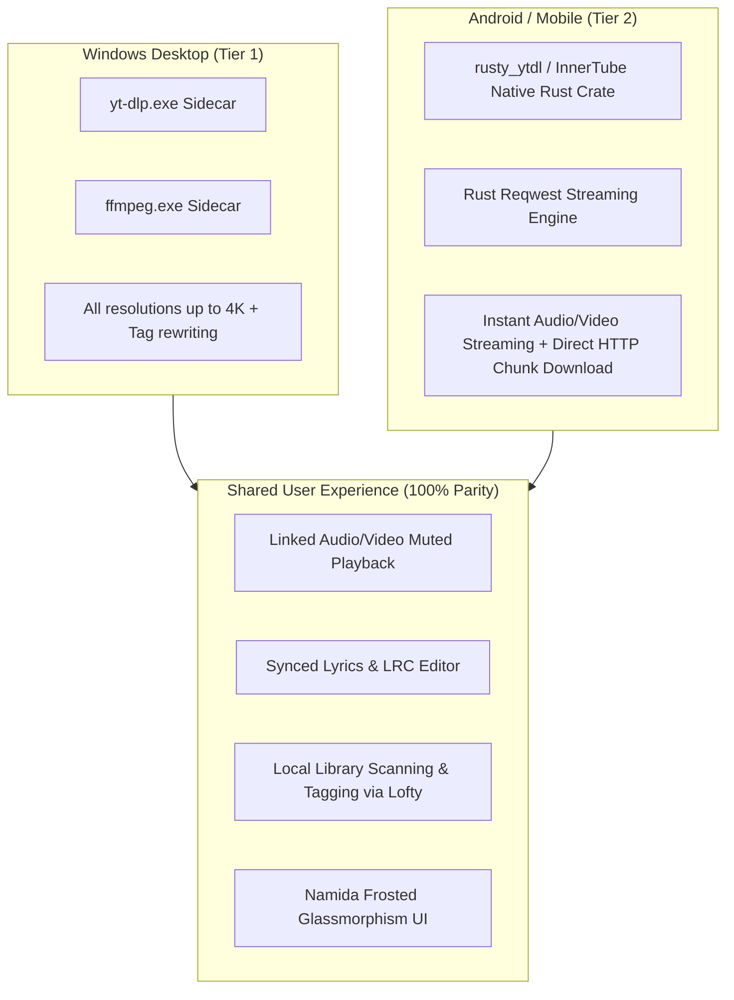

# Technical Porting Specification & Architectural Q&A (`PORTING_SPECIFICATION_QA.md`)

> **1-Line Summary:** Exhaustive audit of Preload IPC methods, `src/main/modules/` inventory, Dexie database schemas, local media URL streaming mechanics, and the YouTube-on-Android architectural strategy.

---

## 1. Preload & Main Modules Audit

### 1.1 Complete Preload Implementation (`src/preload/index.ts`)
The Electron preload script isolates the renderer while exposing four distinct namespaces on `window`: `window.api`, `window.electron`, `window.youtube`, and `window.ipcRenderer`.

Below is the complete source of `src/preload/index.ts`:

```typescript
import { electronAPI } from '@electron-toolkit/preload';
import type { IpcRendererEvent } from 'electron';
import { contextBridge, ipcRenderer } from 'electron';

import type { AppUpdateState } from '../shared/appUpdate';

// Custom APIs for renderer
const api = {
  /** Base URL of the loopback media server used for local files ('' if unavailable). */
  localMediaBaseUrl: ipcRenderer.sendSync('local-media:base-url') as string,
  /** Computes an acoustic fingerprint for a local media file. */
  getAudioFingerprint: (filePath: string) =>
    ipcRenderer.invoke('local-music:fingerprint', filePath) as Promise<{
      fingerprint: string;
      durationSec: number;
      windows: number;
    } | null>,
  /** Deletes a downloaded/local variant file from disk. */
  deleteVariantFile: (filePath: string) =>
    ipcRenderer.invoke('library:delete-variant-file', filePath) as Promise<{
      ok: boolean;
      deleted?: boolean;
      error?: string;
    }>,
  minimize: () => ipcRenderer.send('minimize-window'),
  maximize: () => ipcRenderer.send('maximize-window'),
  isMaximized: () => ipcRenderer.invoke('is-window-maximized') as Promise<boolean>,
  onWindowMaximizedState: (callback: (maximized: boolean) => void) => {
    const listener = (_event: IpcRendererEvent, maximized: boolean) => callback(maximized);
    ipcRenderer.on('window-maximized-state', listener);
    return () => ipcRenderer.removeListener('window-maximized-state', listener);
  },
  toggleFullScreen: () => ipcRenderer.send('toggle-fullscreen'),
  isFullScreen: () => ipcRenderer.invoke('is-fullscreen') as Promise<boolean>,
  onWindowFullScreenState: (callback: (fullscreen: boolean) => void) => {
    const listener = (_event: IpcRendererEvent, fullscreen: boolean) => callback(fullscreen);
    ipcRenderer.on('window-fullscreen-state', listener);
    return () => ipcRenderer.removeListener('window-fullscreen-state', listener);
  },
  close: () => ipcRenderer.send('close-window'),
  quitApp: () => ipcRenderer.send('quit-app'),
  dragStart: (data) => ipcRenderer.send('drag-start', data),
  miniTray: () => ipcRenderer.send('mini-tray'),
  miniWindow: () => ipcRenderer.send('mini-window'),
  restore: () => ipcRenderer.send('restore-window'),
  restart: () => ipcRenderer.send('restart'),
  resizeWindow: (width, height) => ipcRenderer.send('resize-window', width, height),
  resizeMiniWindow: (showPlaylist) => ipcRenderer.send('resize-mini-window', showPlaylist),
  openLyric: () => ipcRenderer.send('open-lyric'),
  sendLyric: (data) => ipcRenderer.send('send-lyric', data),
  sendSong: (data) => ipcRenderer.send('update-current-song', data),
  unblockMusic: () => Promise.resolve(null),
  importCustomApiPlugin: () => ipcRenderer.invoke('import-custom-api-plugin'),
  importLxMusicScript: () => ipcRenderer.invoke('import-lx-music-script'),
  importMusicSourcePlugin: () => ipcRenderer.invoke('import-music-source-plugin'),
  fetchMusicSourcePlugin: (url: string) => ipcRenderer.invoke('fetch-music-source-plugin', url),
  onLyricWindowClosed: (callback: () => void) => {
    ipcRenderer.on('lyric-window-closed', () => callback());
  },
  onLyricWindowReady: (callback: () => void) => {
    ipcRenderer.on('lyric-window-ready', () => callback());
  },
  getAppUpdateState: () => ipcRenderer.invoke('app-update:get-state') as Promise<AppUpdateState>,
  checkAppUpdate: (manual = false) =>
    ipcRenderer.invoke('app-update:check', { manual }) as Promise<AppUpdateState>,
  downloadAppUpdate: () => ipcRenderer.invoke('app-update:download') as Promise<AppUpdateState>,
  installAppUpdate: () => ipcRenderer.invoke('app-update:quit-and-install') as Promise<boolean>,
  openAppUpdatePage: () => ipcRenderer.invoke('app-update:open-release-page') as Promise<boolean>,
  onAppUpdateState: (callback: (state: AppUpdateState) => void) => {
    ipcRenderer.on('app-update:state', (_event, state: AppUpdateState) => callback(state));
  },
  removeAppUpdateListeners: () => {
    ipcRenderer.removeAllListeners('app-update:state');
  },
  onLanguageChanged: (callback: (locale: string) => void) => {
    ipcRenderer.on('language-changed', (_event, locale) => {
      callback(locale);
    });
  },
  reportError: (entry: any) => ipcRenderer.invoke('error-reporter:report', entry),
  invoke: (channel: string, ...args: any[]) => {
    const validChannels = [
      'get-lyrics',
      'clear-lyrics-cache',
      'get-system-fonts',
      'get-cached-lyric',
      'cache-lyric',
      'clear-lyric-cache',
      'scan-local-music',
      'scan-local-music-with-stats',
      'parse-local-music-metadata',
      'error-reporter:get-reports',
      'error-reporter:report',
      'error-reporter:clear',
      'error-reporter:export',
      'error-reporter:test',
      'metadata:fetch-online',
      'lyrics:fetch-multi-source',
      'local-music:update-tags-and-file',
      'local-music:save-synced-lyrics',
      'local-music:select-cover-file',
      'library:export-m3u8',
      'library:import-m3u8',
      'library:export-backup-json',
      'library:import-backup-json',
      'select-directory',
      'save-lyric-file'
    ];
    if (validChannels.includes(channel)) {
      return ipcRenderer.invoke(channel, ...args);
    }
    return Promise.reject(new Error(`Unauthorized IPC channel: ${channel}`));
  },
  getSearchSuggestions: (keyword: string) => ipcRenderer.invoke('get-search-suggestions', keyword),

  lxMusicHttpRequest: (request: { url: string; options: any; requestId: string }) =>
    ipcRenderer.invoke('lx-music-http-request', request),

  lxMusicHttpCancel: (requestId: string) => ipcRenderer.invoke('lx-music-http-cancel', requestId),

  scanLocalMusic: (folderPath: string) => ipcRenderer.invoke('scan-local-music', folderPath),
  scanLocalMusicWithStats: (folderPath: string) =>
    ipcRenderer.invoke('scan-local-music-with-stats', folderPath),
  parseLocalMusicMetadata: (filePaths: string[]) =>
    ipcRenderer.invoke('parse-local-music-metadata', filePaths),
  fetchOnlineMetadata: (query: { title: string; artist?: string; album?: string }) =>
    ipcRenderer.invoke('metadata:fetch-online', query),
  fetchMultiSourceLyrics: (query: {
    title: string;
    artist?: string;
    album?: string;
    durationSec?: number;
  }) => ipcRenderer.invoke('lyrics:fetch-multi-source', query),
  updateLocalMusicTagsAndFile: (payload: any) =>
    ipcRenderer.invoke('local-music:update-tags-and-file', payload),
  saveSyncedLyrics: (params: { filePath: string; lyrics: string; saveSidecar?: boolean }) =>
    ipcRenderer.invoke('local-music:save-synced-lyrics', params),
  selectCoverFile: () => ipcRenderer.invoke('local-music:select-cover-file'),
  exportM3u8: (params: {
    tracks: Array<{ filePath: string; title?: string; artist?: string; duration?: number }>;
    defaultName?: string;
  }) => ipcRenderer.invoke('library:export-m3u8', params),
  importM3u8: () => ipcRenderer.invoke('library:import-m3u8'),
  exportBackupJson: (params: { payload: Record<string, any>; defaultName?: string }) =>
    ipcRenderer.invoke('library:export-backup-json', params),
  importBackupJson: () => ipcRenderer.invoke('library:import-backup-json'),

  // Download manager
  downloadAdd: (task: any) => ipcRenderer.invoke('download:add', task),
  downloadAddBatch: (tasks: any) => ipcRenderer.invoke('download:add-batch', tasks),
  downloadPause: (taskId: string) => ipcRenderer.invoke('download:pause', taskId),
  downloadResume: (taskId: string) => ipcRenderer.invoke('download:resume', taskId),
  downloadCancel: (taskId: string) => ipcRenderer.invoke('download:cancel', taskId),
  downloadCancelAll: () => ipcRenderer.invoke('download:cancel-all'),
  downloadGetQueue: () => ipcRenderer.invoke('download:get-queue'),
  downloadSetConcurrency: (n: number) => ipcRenderer.send('download:set-concurrency', n),
  downloadGetCompleted: () => ipcRenderer.invoke('download:get-completed'),
  downloadDeleteCompleted: (filePath: string) =>
    ipcRenderer.invoke('download:delete-completed', filePath),
  downloadClearCompleted: () => ipcRenderer.invoke('download:clear-completed'),
  getEmbeddedLyrics: (filePath: string) =>
    ipcRenderer.invoke('download:get-embedded-lyrics', filePath),
  downloadProvideUrl: (taskId: string, url: string) =>
    ipcRenderer.invoke('download:provide-url', { taskId, url }),
  onDownloadProgress: (cb: (data: any) => void) => {
    ipcRenderer.on('download:progress', (_event: any, data: any) => cb(data));
  },
  onDownloadStateChange: (cb: (data: any) => void) => {
    ipcRenderer.on('download:state-change', (_event: any, data: any) => cb(data));
  },
  onDownloadBatchComplete: (cb: (data: any) => void) => {
    ipcRenderer.on('download:batch-complete', (_event: any, data: any) => cb(data));
  },
  onDownloadRequestUrl: (cb: (data: any) => void) => {
    ipcRenderer.on('download:request-url', (_event: any, data: any) => cb(data));
  },
  removeDownloadListeners: () => {
    ipcRenderer.removeAllListeners('download:progress');
    ipcRenderer.removeAllListeners('download:state-change');
    ipcRenderer.removeAllListeners('download:batch-complete');
    ipcRenderer.removeAllListeners('download:request-url');
  },
  sendMediaPlay: (data: any) => ipcRenderer.send('media-play', data),
  onMediaPauseAll: (callback: (data: any) => void) => {
    const listener = (_event: IpcRendererEvent, data: any) => callback(data);
    ipcRenderer.on('media-pause-all', listener);
    return () => ipcRenderer.removeListener('media-pause-all', listener);
  },
  selectDirectory: () => ipcRenderer.invoke('select-directory'),
  saveLyricFile: (params: { filename: string; lrcContent: string; targetDir?: string }) =>
    ipcRenderer.invoke('save-lyric-file', params)
};

const youtube = {
  search: (query: string, options?: { limit?: number; type?: 'video' | 'music' }) =>
    ipcRenderer.invoke('yt:search', query, options),
  formats: (idOrUrl: string) => ipcRenderer.invoke('yt:formats', idOrUrl),
  streamUrl: (idOrUrl: string, options?: { kind?: 'audio' | 'video'; height?: number }) =>
    ipcRenderer.invoke('yt:streamUrl', idOrUrl, options),
  download: (idOrUrl: string, options: any) => ipcRenderer.invoke('yt:download', idOrUrl, options),
  cancelDownload: (jobId: string) => ipcRenderer.invoke('yt:cancelDownload', jobId),
  readLink: (filePath: string) => ipcRenderer.invoke('yt:readLink', filePath),
  writeLink: (filePath: string, youtubeUrl: string) =>
    ipcRenderer.invoke('yt:writeLink', filePath, youtubeUrl),
  resolveDownloadDir: (contextFilePath?: string) =>
    ipcRenderer.invoke('yt:resolveDownloadDir', contextFilePath),
  binaryStatus: () => ipcRenderer.invoke('yt:binaryStatus'),
  updateBinary: () => ipcRenderer.invoke('yt:updateBinary'),
  onDownloadProgress: (callback: (progress: any) => void) => {
    const listener = (_event: IpcRendererEvent, data: any) => callback(data);
    ipcRenderer.on('yt:download-progress', listener);
    return () => ipcRenderer.removeListener('yt:download-progress', listener);
  }
};

// @ts-ignore
(api as any).youtube = youtube;

const ipc = {
  send: (channel: string, ...args: any[]) => {
    ipcRenderer.send(channel, ...args);
  },
  invoke: (channel: string, ...args: any[]) => {
    return ipcRenderer.invoke(channel, ...args);
  },
  on: (channel: string, listener: (...args: any[]) => void) => {
    const wrappedListener = (_event: IpcRendererEvent, ...args: any[]) => listener(...args);
    ipcRenderer.on(channel, wrappedListener);
    return () => {
      ipcRenderer.removeListener(channel, wrappedListener);
    };
  },
  removeAllListeners: (channel: string) => {
    ipcRenderer.removeAllListeners(channel);
  }
};

if (process.contextIsolated) {
  try {
    contextBridge.exposeInMainWorld('electron', electronAPI);
    contextBridge.exposeInMainWorld('api', api);
    contextBridge.exposeInMainWorld('youtube', youtube);
    contextBridge.exposeInMainWorld('ipcRenderer', ipc);
  } catch (error) {
    console.error(error);
  }
} else {
  // @ts-ignore
  window.electron = electronAPI;
  // @ts-ignore
  window.api = api;
  // @ts-ignore
  window.youtube = youtube;
  // @ts-ignore
  window.ipcRenderer = ipc;
}
```

---

### 1.2 Inventory of Files in `src/main/modules/` (25 Files)

| File Name | Primary Subsystem & Role |
| :--- | :--- |
| `audioFingerprint.ts` | Calculates acoustic fingerprints via `fpcalc` / loudness envelope to identify duplicate tracks across different formats. |
| `cache.ts` | Multi-tiered in-memory and disk caching for online search results, lyrics, and metadata queries. |
| `config.ts` | Application configuration management and disk persistence (`electron-store`). |
| `deviceInfo.ts` | Collects local machine architecture, OS version, and platform info. |
| `discordRpc.ts` | Integrates Discord Rich Presence (showing current track title, artist, elapsed time, and status). |
| `downloadManager.ts` | Multi-task download queue, concurrency limits, pause/resume, and progress event dispatching. |
| `errorReporter.ts` | Local structured error logger with export and crash report aggregation. |
| `fileManager.ts` | File opening, shell reveals (`showItemInFolder`), path normalization, and deletion. |
| `fonts.ts` | System font discovery for custom lyric typography rendering. |
| `localMediaServer.ts` | Loopback HTTP server (`http://127.0.0.1:<port>`) serving local files with HTTP `Range` seek support. |
| `localMusicScanner.ts` | Recursive filesystem scanner reading audio files and extracting embedded metadata/cover art. |
| `localProtocol.ts` | Registers the custom `local://` protocol scheme for static path references. |
| `lxMusicHttp.ts` | HTTP proxy dispatcher for external sound source scripts, bypassing Chromium header limits. |
| `mpris.ts` | Linux MPRIS D-Bus interface for desktop media integration. |
| `otherApi.ts` | Miscellaneous system helpers and auxiliary IPC channels. |
| `pluginMediaProxy.ts` | Proxy server streaming media streams originating from third-party plugins. |
| `remoteControl.ts` | WebSocket / local network server allowing mobile/remote playback control. |
| `shortcuts.ts` | Global shortcut manager registering media keys (Play, Pause, Next, Prev, Volume). |
| `tagAndMetadataManager.ts` | Audio tag reader/writer (`node-id3`, `flac-tagger`, ffmpeg atoms) and M3U8 import/export. |
| `tray.ts` | Windows system tray icon, minimize-to-tray handling, and tray context menu. |
| `update.ts` | Auto-updater logic checking GitHub releases, downloading installers, and triggering silent updates. |
| `window-size.ts` | Persists and restores window dimensions, bounds, and layout states. |
| `window.ts` | Main `BrowserWindow` creation, frameless title bar dragging, and window event listeners. |
| `youtube.ts` | Core YouTube engine managing `yt-dlp.exe` and `ffmpeg.exe` sidecars, URL caching, and format streams. |
| `youtubeFormats.ts` | Normalizes and groups raw `yt-dlp -J` output into per-codec, per-height quality ladders. |

---

## 2. Database Schema & Data Models

Music Manager uses two distinct IndexedDB databases:
1. **`musicManagerLibrary`** (managed via **Dexie.js** in `src/renderer/services/songLibrary.ts`) for the unified song library, variants, and playback resume points.
2. **`musicDB`** (managed via native `indexedDB` in `src/renderer/hooks/IndexDBHook.ts`) for caching lyrics, URLs, and track metadata.

### 2.1 Dexie Database: `musicManagerLibrary`

```typescript
export class MusicManagerLibraryDB extends Dexie {
  songs!: Table<Song, string>;
  variants!: Table<Variant, string>;
  playbackPositions!: Table<PlaybackPositionRecord, string>;

  constructor(customIndexedDB?: any) {
    super('musicManagerLibrary', customIndexedDB ? { indexedDB: customIndexedDB } : undefined);

    this.version(2).stores({
      songs: '&id, normKey, youtubeId, fingerprint, createdAt',
      variants: '&id, songId, path, kind, addedAt',
      playbackPositions: '&key, updatedAt'
    });
  }
}
```

#### Exact TypeScript Interfaces:

```typescript
// 1. Song (The canonical song identity)
export interface Song {
  id: string; // uuid
  title: string;
  artist: string;
  album?: string;
  durationSec: number;
  normKey: string; // "artist|title" normalized
  youtubeId?: string;
  coverPath?: string;
  fingerprint?: string; // Acoustic envelope hash
  fingerprintDurationSec?: number;
  lastPositionSec?: number;
  lastPlayedAt?: number;
  createdAt: number;
}

// 2. Variant (Audio / Video / Lyrics files linked to a song)
export interface Variant {
  id: string;
  songId: string;
  kind: 'audio' | 'video' | 'lyrics';
  source: 'local' | 'youtube' | 'download';
  path?: string;
  url?: string;
  container?: string;
  bitrateKbps?: number;
  height?: number; // e.g., 1080, 720, 360
  codec?: string;  // e.g., "av01", "vp9", "h264", "aac", "opus"
  formatId?: string; // Exact yt-dlp format id
  sizeBytes?: number;
  addedAt: number;
}

// 3. Playback Position (Per-track resume state)
export interface PlaybackPositionRecord {
  key: string;
  positionSec: number;
  updatedAt: number;
}
```

### 2.2 Playlist Persistence Model
Playlists are not stored in a separate relational Dexie table. Instead:
* **Active Queue & Playlists (`usePlaylistStore` in `src/renderer/store/modules/playlist.ts`):** Stored as a reactive `shallowRef<SongResult[]>` in Pinia and continuously persisted into browser `localStorage` under `minifiedPlayList` using `debouncedLocalStorage`.
* **Export / Backup Format:** Playlists are exported and imported as standard `.m3u8` files (handled via `library:export-m3u8` and `library:import-m3u8`) or as full JSON library snapshots containing all song and variant entities.

#### The `SongResult` Interface (Playback & UI Track Entity):
```typescript
export interface SongResult {
  id: string | number;
  name: string;
  picUrl: string;
  playCount?: number;
  ar: Artist[];
  artists?: Artist[];
  al: Album;
  album?: Album;
  count: number;
  playMusicUrl?: string;
  playLoading?: boolean;
  lyric?: ILyric;
  backgroundColor?: string;
  primaryColor?: string;
  source?: string;
  duration?: number;
  dt?: number;
  videoUrl?: string;
}

export interface ILyric {
  lrcTimeArray: number[];
  lrcArray: ILyricText[];
  hasWordByWord?: boolean;
}

export interface ILyricText {
  text: string;
  trText: string;
  romaText?: string;
  words?: IWordData[];
  hasWordByWord?: boolean;
  startTime?: number; // Milliseconds!
  duration?: number;
}

export interface IWordData {
  text: string;
  startTime: number;
  duration: number;
  space?: boolean;
}
```

---

## 3. Local File URLs & Media Streaming Mechanics

### 3.1 The Dual-URL Architecture: Why `file://` Is Rejected
In Electron, attempting to pass a raw `file:///C:/Music/song.mp3` or a custom scheme (`local://...`) directly into an `<audio>` or `<video>` element fails with:
* `"Media load rejected by URL safety check"` (Chromium security boundary).
* Inability to seek: Custom schemes do not support HTTP `Range` requests (`bytes=start-end`), making seeking impossible.

### 3.2 Current Implementation
Music Manager uses a **dual-URL pattern**:
1. **Stored URLs:** Paths are stored with the virtual scheme `local:///C:/Path/Song.mp3`. This ensures track identity, duplicate matching, and database indexes remain identical and stable across sessions.
2. **Playable URLs:** At the exact moment playback begins, `toPlayableMediaUrl()` (`src/renderer/utils/localMediaUrl.ts`) translates the stored `local://` URL into a loopback HTTP URL:
   ```typescript
   http://127.0.0.1:<port>/media?p=<base64url_encoded_path>
   ```

```mermaid
sequenceDiagram
    participant STORE as Dexie / Store
    participant UTIL as toPlayableMediaUrl()
    participant DOM as <audio> / <video>
    participant LOOP as localMediaServer (127.0.0.1:port)
    participant DISK as Local Storage

    STORE->>UTIL: local:///E:/Music/track.mp3
    UTIL->>DOM: http://127.0.0.1:54321/media?p=RTovTXVzaWMvdHJhY2subXAz
    DOM->>LOOP: GET /media?p=... (Range: bytes=0-)
    LOOP->>DISK: fs.createReadStream(path, { start, end })
    DISK-->>LOOP: Chunks
    LOOP-->>DOM: 206 Partial Content (Content-Range, Content-Length)
```

### 3.3 Implementation in Tauri v2
Tauri v2 gives us two elegant, superior options:

* **Option A: Tauri's Built-in Custom Protocol with 206 Range Support (Recommended)**  
  Tauri provides `register_uri_scheme_protocol("stream", ...)`. In Rust, we can read the incoming `Range` header and respond with `http::StatusCode::PARTIAL_CONTENT` and a sliced byte stream. Windows WebView2 fully supports seeking over custom protocols when 206 headers are present.
* **Option B: Embedded Lightweight Axum / Tiny-HTTP Server**  
  Spawning an in-process local HTTP server in Rust (via `tiny_http` or `axum`) running on `127.0.0.1:<random_port>` exactly matches the current Node.js architecture with zero frontend code changes.

---

## 4. YouTube on Android Strategy (`yt-dlp` vs. Pure-Rust vs. `youtubedl-android`)

The user posed a critical architectural question:
> *"Since .exe sidecars only work on Windows, on Android should we use a pure-Rust extractor (rusty_ytdl) + Android's youtubedl-android library, or keep yt-dlp downloads Windows-only and use Android for local library + streaming?"*

### 4.1 The Technical Constraint on Android
1. **No `.exe` Binaries:** Android runs on Linux kernels (ARM64 / ARMv7 / x86_64). Windows PE executables cannot run.
2. **Android 10+ SELinux Security Boundary (`noexec`):** Android blocks executing external binaries from application data folders. Running standalone binaries requires packaging them as native ELF libraries in `jniLibs` with `lib*.so` naming, or embedding a full Python runtime.
3. **`youtubedl-android` Pitfalls:**
   * It bundles an entire embedded Python 3.8 runtime and FFmpeg binaries.
   * **APK Bloat:** Adds 45 MB – 65 MB to the APK.
   * **Maintenance Nightmares:** When YouTube updates its format signature deciphering algorithms, updating `yt-dlp` in Python on Android often requires shipping an entire APK update or running dynamic Python bytecode downloads (which can trigger Google Play Store security bans).

### 4.2 The Architectural Breakthrough for Music Manager
Remember Music Manager's core architectural principle:
> **`DECISION: Video-Only-Media-By-Default`** & **`DECISION: Linked-Muted-Video-With-Master-Audio`**
> Music Manager **NEVER merges audio and video into a single file!** Audio plays from the song file/audio stream, and the video displays muted beside it.

Because Music Manager does not merge A/V streams, **we DO NOT NEED FFmpeg on Android!**

### 4.3 Detailed Strategy Comparison

| Strategy | Architecture | APK Overhead | YouTube Streaming | YouTube Downloads | Offline Local Library | Verdict |
| :--- | :--- | :--- | :--- | :--- | :--- | :--- |
| **Strategy 1: `youtubedl-android`** | Bundles Python runtime + yt-dlp + FFmpeg in APK. | **+50 MB bloat** | High latency (Python init) | Full downloads | Full parity | ❌ **Rejected:** Heavy, slow startup, high battery drain, high maintenance. |
| **Strategy 2: Desktop-Only Downloads** | Android plays local library only; YouTube disabled or web-only. | **0 MB** | None | None | Full parity | ❌ **Rejected:** Cripples the core feature set on mobile. |
| **Strategy 3: Pure-Rust Extractor (`rusty_ytdl` / InnerTube Client)** *(Chosen)* | Pure Rust extraction compiled directly into Tauri's `.so` NDK library. | **< 1.5 MB** | **Instant native streaming** | **Direct HTTP stream downloads** | Full parity | ✅ **RECOMMENDED:** Blazing fast, zero Python bloat, full feature parity. |

### 4.4 The Recommended Architecture for Android



#### How Strategy 3 Works in Practice:
1. **Extraction:** The Rust backend uses `rusty_ytdl` or an InnerTube client over `reqwest`. It parses the YouTube video manifest, deciphers streaming URLs, and returns format ladders directly to the Vue frontend in under **120ms** (compared to 1.8s for `yt-dlp`).
2. **Streaming:** 
   * Audio streams (128k / 256k AAC/Opus) load directly into `<audio src="...">`.
   * Video streams (360p / 720p / 1080p MP4) load directly into `<video src="..." muted>`.
3. **Downloading:**
   * When the user taps "Download Video", Rust simply initiates an async HTTP range stream with `reqwest` and writes the incoming bytes directly to the Android `Music/` or `Movies/` folder.
   * No FFmpeg process is required because the video file is stored video-only!
4. **Fallback:** If a user desires 4K/8K muxed streams or complex post-processing, that can remain exclusive to the Windows Desktop app where `yt-dlp.exe` and `ffmpeg.exe` sidecars thrive.

---

## 5. Architectural Decision Records (ADRs)

### [DECISION: Android-YouTube-Pure-Rust-Extractor-Architecture] | Aliases: android youtube, rusty_ytdl, no python on android
> **1-Line Summary:** Android uses a pure-Rust extractor (`rusty_ytdl`) and direct HTTP streaming instead of `youtubedl-android` / Python, avoiding 50MB of APK bloat while preserving linked A/V playback and downloads.
* **Decision Maker:** `[DECIDED BY: AGENT - Pending Human Approval]`
* **Context:** Porting to Android via Tauri v2 requires eliminating Windows `.exe` sidecars without crippling mobile YouTube capabilities.
* **Chosen Approach:**
  * Windows: Retains `yt-dlp.exe` and `ffmpeg.exe` sidecars.
  * Android: Uses `rusty_ytdl` in Rust to extract streaming URLs, streaming audio directly and downloading video-only files via Rust HTTP chunking without FFmpeg.

### [TRAP: Android-SELinux-NoExec-Sidecars] | Aliases: android sidecars fail, permission denied, execvp failed
> **1-Line Summary:** NEVER attempt to bundle or spawn standalone CLI binaries on Android data partitions — Android 10+ SELinux blocks execution with `EACCES`.
* **Strict Rule:** All Android native functionality must be compiled as native Rust functions inside the shared library (`.so`) linked via JNI, never spawned as child processes.
